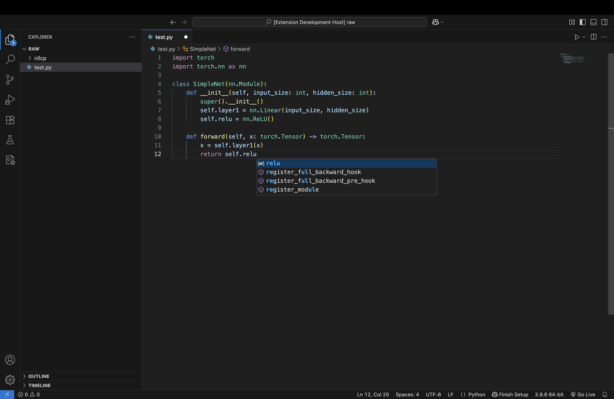
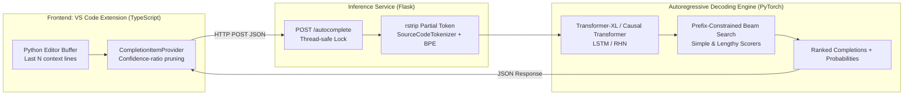
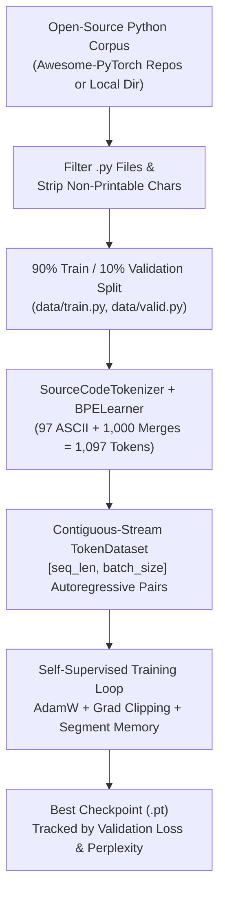

<div align="center">

# ⚡ SSL-For-Code

### Self-Supervised Learning for Python Code Auto-Completion

`Python 3.9+` · `PyTorch 2.0+` · `Transformer-XL` · `1,097-Token BPE` · `Prefix-Constrained Beam Search` · `Flask REST API` · `VS Code Extension (TypeScript)` · `MIT License`

*An end-to-end self-supervised code intelligence system combining a custom heap-accelerated BPE tokenizer, four swappable PyTorch autoregressive architectures (Transformer-XL, Causal Transformer, LSTM, RHN), prefix-constrained beam search decoding, a thread-safe Flask inference server, an interactive GitHub Pages playground, and a native VS Code extension.*

[System Architecture](#system-architecture) · [Technical Deep Dive](#technical-deep-dive) · [Project Structure](#project-structure) · [Quickstart](#quickstart) · [REST API](#rest-api-reference) · [VS Code Extension](#vs-code-extension)

</div>

---

## Overview

**SSL-For-Code** trains autoregressive neural language models directly on raw open-source Python repositories via **Self-Supervised Learning (SSL)** — requiring zero manual labels. Given any partial Python context in an editor, the model predicts the next subword tokens in real time, runs prefix-constrained beam search across identifier boundaries, and streams ranked completions straight into VS Code's IntelliSense dropdown.

<p align="center">
  
  <br />
  <em>Real-time Python code auto-completion inside VS Code backed by the local Flask inference server.</em>
</p>

### Key Capabilities

- **Self-Supervised Next-Token Objective** — Learns Python syntax, indentation, PyTorch idioms, and API conventions directly from unlabeled `.py` corpora.
- **Custom Heap-Accelerated BPE Tokenizer** — Splits Python code at identifier/symbol boundaries and applies 1,000 learned Byte Pair Encoding merges over 97 printable ASCII characters (`1,097`-token cached vocabulary in `data/cache/bpe.json`) in $O(n \log n)$ time using doubly-linked arrays and a priority queue.
- **Four Swappable PyTorch Architectures** — Unified `AutoregressiveModel` interface `(src, state) -> (logits, new_state)` supporting **Transformer-XL** (relative multi-head attention + segment-level recurrence), **Causal Transformer**, **Multi-Layer LSTM**, and **Recurrent Highway Network (RHN)**.
- **Prefix-Constrained Beam Search** — Includes both raw-probability decoding (`BeamSearchSimple`) and length-weighted decoding (`BeamSearchLengthy`, $\text{score} = |t|^{0.2} \cdot p$) with identifier-boundary and newline stopping rules.
- **Code Intelligence Suite** — Built-in keystroke-saving benchmark (`eval_sample.py`), token-level probability anomaly detector (`anomalies.py`), and autoregressive code generator (`generate.py`).
- **Production-Style Local Serving & IDE Client** — Thread-safe Flask REST API (`/health`, `/tokenize`, `/autocomplete`) with a zero-checkpoint `--demo` mode and a configurable TypeScript VS Code extension.
- **Interactive Browser Playground** — Static GitHub Pages web app (`docs/index.html`) running the real 1,097-token BPE vocabulary and an interactive beam-search / confidence-ratio simulator directly in the browser.

---

## System Architecture



### Data & Self-Supervised Training Pipeline



---

## Technical Deep Dive

### 1. Self-Supervised Causal Language Modeling

Given a tokenized Python source sequence $x = (x_1, x_2, \dots, x_T)$ from the vocabulary $\mathcal{V}$ ($|\mathcal{V}| = 1{,}097$ for BPE or $97$ for character-level modeling), the model minimizes the autoregressive negative log-likelihood:

$$\mathcal{L}_{\text{SSL}}(\theta) = -\frac{1}{T} \sum_{t=1}^{T} \log P_{\theta}\left(x_t \mid x_{<t}\right)$$

During training, sequences are arranged into contiguous parallel streams of shape `[seq_len, batch_size]` so recurrent hidden states (LSTM/RHN) and segment-level memories (Transformer-XL) carry context continuously across consecutive chunks without resetting at arbitrary segment boundaries.

### 2. Source-Code Aware BPE Tokenization

Standard whitespace tokenizers fragment Python punctuation and indentation inconsistently. `SourceCodeTokenizer` (`ssl_for_code/dataset/break_words.py`) first partitions source text into alternating **identifier spans** (`[A-Za-z0-9_]+`) and **symbol/whitespace spans** (operators, brackets, indentation, newlines).

`BPELearner` (`ssl_for_code/dataset/bpe.py`) then learns merge rules using a **max-heap + doubly-linked index arrays** (`word_code_prev`, `word_code_next`), updating only affected neighbor pairs on each merge. At inference time, `_BPEEncoder` applies learned merge ranks in $O(n \log n)$ with an LRU word cache (`maxsize=4096`).

For example, the snippet:
```python
def forward(self, x):
    return self.relu(x)
```
is compressed from **48 characters into 22 subword tokens** (`2.18x` compression) using the pre-trained `data/cache/bpe.json` vocabulary, keeping common Python tokens (`def`, `forward`, `self`, `return`, `    `, `):`) as single token IDs.

### 3. Model Zoo Comparison

All four models inherit from `AutoregressiveModel` (`ssl_for_code/models/__init__.py`) and expose an identical `(src, state) -> (logits, new_state)` signature:

| Architecture | Module | Context / Recurrence Mechanism | Key Hyperparameters | Best Use Case |
| :--- | :--- | :--- | :--- | :--- |
| **Transformer-XL** *(Primary)* | `ssl_for_code/models/xl.py` | Relative multi-head attention ($u, v$ biases + relative shift) + segment-level memory (`MemoryUpdater`, `mem_len=256`) | `n_layers=6`, `n_heads=8`, `d_model=512`, `d_ff=2048` | Long-range cross-function & class-level code completion |
| **Causal Transformer** | `ssl_for_code/models/transformer.py` | Sinusoidal positional encoding + pre-norm encoder with upper-triangular causal mask | `n_layers=6`, `n_heads=8`, `d_model=512`, `GELU` | Fixed-window parallel training baseline |
| **Multi-Layer LSTM** | `ssl_for_code/models/lstm.py` | Stacked recurrent cells with detached `(h_n, c_n)` state persistence | `n_layers=2`, `hidden_size=512`, `dropout=0.2` | Lightweight low-memory CPU/edge inference |
| **Recurrent Highway Network** | `ssl_for_code/models/highway.py` | Coupled transform/carry gates $s_l = H \odot T + s_{l-1} \odot (1 - T)$ across recurrence depth $L$ | `n_layers=2`, `depth=2`, `hidden_size=512` | Deep per-step recurrent transitions without vanishing gradients |

### 4. Prefix-Constrained Beam Search & IDE Filtering

When the cursor sits mid-identifier (e.g., `return self.rel`), `Predictor.rstrip()` detaches the trailing incomplete span (`rest = "rel"`) and encodes the clean prefix (`"return self."`). Beam search then filters candidate tokens whose prefix matches `rest` and terminates each branch when:
- **`NextWordPredictionComplete`**: Generated length exceeds `min_length` and crosses an identifier $\leftrightarrow$ non-identifier boundary.
- **`NextWordNewLinePredictionComplete`**: Same as above, or stops immediately upon encountering `\n`.

Two beam scoring modes are included:
- **`BeamSearchSimple`**: Ranks candidates by joint probability $P(t_1, \dots, t_k)$.
- **`BeamSearchLengthy`**: Counteracts short-token bias using length-weighted scoring:

$$\text{score}(t, p) = \max(|t|, 1)^{\alpha} \cdot p \quad (\alpha = 0.2)$$

On the IDE side, the VS Code extension applies **confidence-ratio pruning** ($p_i > r \cdot p_{i+1}$, default $r = 4.0$), trims trailing duplicate suffixes already to the right of the cursor, deduplicates suggestions, and re-triggers IntelliSense seamlessly for multi-token flows.

---

## Project Structure

```text
ssl-for-code/
├── .github/workflows/
│   ├── ci.yml                     # Cross-platform CI (Ubuntu/macOS, Python 3.10/3.12, TS build)
│   └── pages.yml                  # Auto-deploys docs/ interactive playground to GitHub Pages
├── assets/
│   └── vscode-autocomplete.png    # VS Code autocompletion screenshot
├── data/
│   ├── cache/                     # Pre-trained BPE (1,097 tokens) & Char (97 tokens) caches
│   │   ├── bpe.json
│   │   ├── itos.json
│   │   ├── n_tokens.json
│   │   └── stoi.json
│   └── pytorch_awesome.md         # Curated Awesome-PyTorch repository list
├── docs/
│   ├── index.html                 # Interactive GitHub Pages BPE & Beam Search Playground
│   └── assets/                    # Static assets served by GitHub Pages
├── ssl_for_code/
│   ├── __init__.py
│   ├── cli.py                     # Unified CLI (`ssl-for-code tokenize ...`)
│   ├── train.py                   # Single-device (CUDA / MPS / CPU) training pipeline
│   ├── distributed.py             # Multi-GPU DistributedDataParallel (torchrun) trainer
│   ├── server.py                  # Thread-safe Flask REST API server (+ --demo mode)
│   ├── dataset/
│   │   ├── __init__.py            # Tokenizer ABC & ID_CHARS
│   │   ├── break_words.py         # SourceCodeTokenizer & NoTokenizer
│   │   ├── bpe.py                 # Heap-accelerated BPELearner, BPEEnDe, BPE
│   │   ├── dataset.py             # CharacterTokenizer, SourceCodeDataset, DataLoaders
│   │   └── create_dataset.py      # GitHub & local corpus builder (90/10 train/valid split)
│   ├── models/
│   │   ├── __init__.py            # AutoregressiveModel ABC & build_model() factory
│   │   ├── state.py               # StateUpdater & Transformer-XL MemoryUpdater
│   │   ├── xl.py                  # Transformer-XL (relative attention + segment memory)
│   │   ├── transformer.py         # Causal Transformer with sinusoidal PE
│   │   ├── lstm.py                # Multi-layer LSTM
│   │   └── highway.py             # Recurrent Highway Network (RHN)
│   ├── evaluate/
│   │   ├── __init__.py            # Predictor with get_next_token / get_next_word / autocomplete
│   │   ├── beam_search.py         # BeamSearchSimple & boundary completion rules
│   │   ├── beam_search_lengthy.py # Length-normalized BeamSearchLengthy
│   │   ├── factory.py             # Checkpoint loader & Predictor factory
│   │   ├── eval_sample.py         # Keystroke-saving evaluation benchmark
│   │   ├── generate.py            # Autoregressive code generator
│   │   └── anomalies.py           # Token-level probability anomaly detector
│   └── utils/
│       └── io.py                  # Path resolution, JSON cache I/O, CUDA/MPS/CPU auto-device
├── tests/
│   ├── test_tokenizer.py          # Word-breaking, BPE learning/round-trip, dataset split tests
│   ├── test_models.py             # Forward/backward & recurrence tests for all 4 architectures
│   └── test_beam_search_and_server.py # Beam search, generator, anomaly & Flask API tests
├── vscode_extension/
│   ├── package.json               # Extension manifest & configurable settings
│   ├── tsconfig.json              # Strict TypeScript compiler config
│   ├── editor-settings.json       # Recommended VS Code editor settings
│   └── src/extension.ts           # Python CompletionItemProvider client
├── LICENSE
├── Makefile
├── pyproject.toml
└── requirements.txt
```

---

## Quickstart

### 1. Clone & Install

```bash
git clone git@github.com:rajathgadagkar/ssl-for-code.git
cd ssl-for-code
python3 -m venv .venv && source .venv/bin/activate
pip install -e ".[dev]"
```

### 2. Try the BPE Tokenizer CLI (No GPU Required)

```bash
python3 -m ssl_for_code.cli tokenize --code "def forward(self, x): return self.relu(x)"
```

### 3. Build a Python Code Dataset

Download repositories from `data/pytorch_awesome.md`:
```bash
python3 -m ssl_for_code.dataset.create_dataset --num-repos 20 --output-dir data
```

Or build a dataset from any local directory of Python code (great for quick experiments):
```bash
python3 -m ssl_for_code.dataset.create_dataset --source-dir ssl_for_code --output-dir data
```

*(Optional)* Retrain the BPE merge vocabulary on your new corpus:
```bash
python3 -m ssl_for_code.dataset.bpe --input data/train.py --merges 1000
```

### 4. Train a Code Language Model

Train the primary **Transformer-XL** model (auto-selects CUDA, Apple Silicon MPS, or CPU):
```bash
python3 -m ssl_for_code.train \
  --model transformer_xl \
  --tokenizer bpe \
  --n-layers 6 \
  --d-model 512 \
  --n-heads 8 \
  --mem-len 256 \
  --batch-size 12 \
  --seq-len 256 \
  --epochs 32 \
  --lr 1.25e-4
```

Swap `--model` to `transformer`, `lstm`, or `rhn` to benchmark alternative architectures. For multi-GPU training via PyTorch DDP:
```bash
torchrun --nproc_per_node=2 -m ssl_for_code.distributed --model transformer_xl --epochs 32
```

### 5. Launch the Inference Server

Start the Flask API with a trained checkpoint:
```bash
python3 -m ssl_for_code.server --checkpoint checkpoints/transformer_xl_best.pt --port 5000
```

Or launch immediately in lightweight `--demo` mode (no checkpoint needed) to test the API and VS Code extension:
```bash
python3 -m ssl_for_code.server --demo --port 5000
```

---

## REST API Reference

| Endpoint | Method | Description |
| :--- | :--- | :--- |
| `/` | `GET` | Service metadata and available endpoints |
| `/health` | `GET` | Health status, active architecture, and vocabulary size (`1097`) |
| `/tokenize` | `POST` | Tokenizes raw Python code with the cached BPE tokenizer and returns compression stats |
| `/autocomplete` | `POST` | Returns ranked beam-search completions, probabilities, and server latency in ms |

**Example Request (`POST /autocomplete`):**
```bash
curl -X POST localhost:5000/autocomplete \
  -H "Content-Type: application/json" \
  -d '{"prompt": "return self.rel", "beam_size": 5, "min_length": 15}'
```

**Example Response:**
```json
{
  "success": true,
  "prediction": ["u(x)", "u = nn.ReLU()", "ative_attn("],
  "probs": [0.68, 0.22, 0.1],
  "latency_ms": 14.32
}
```

---

## VS Code Extension

1. **Install dependencies & compile TypeScript:**
   ```bash
   cd vscode_extension
   npm install
   npm run compile
   ```
2. **Launch Extension Development Host:**
   Open `vscode_extension/` in VS Code and press `F5` (`Run > Start Debugging`).
3. **Configure Settings** *(optional, in VS Code Settings)*:
   - `sslForCode.serverHost`: Backend hostname (default `localhost`)
   - `sslForCode.serverPort`: Backend port (default `5000`)
   - `sslForCode.contextLines`: Number of preceding lines sent as context (default `20`)
   - `sslForCode.confidenceRatio`: Tail pruning threshold $r$ where $p_i > r \cdot p_{i+1}$ (default `4.0`)

---

## Evaluation & Code Analysis Tools

- **Keystroke Savings Benchmark:**
  ```bash
  python3 -m ssl_for_code.evaluate.eval_sample path/to/file.py --checkpoint checkpoints/transformer_xl_best.pt
  ```
- **Token-Level Anomaly Detection** *(flags statistically surprising tokens below a probability threshold)*:
  ```bash
  python3 -m ssl_for_code.evaluate.anomalies path/to/file.py --checkpoint checkpoints/transformer_xl_best.pt --threshold 0.01
  ```
- **Autoregressive Code Generation:**
  ```bash
  python3 -m ssl_for_code.evaluate.generate --prompt "import torch\nimport torch.nn as nn\n\n" --max-tokens 64
  ```

### Experimental Training Snapshot

On a 20-repository Awesome-PyTorch corpus (`pytorch/audio`, `allenai/allennlp`, `OpenNMT/OpenNMT-py`, `pytorch/captum`, `IBM/pytorch-seq2seq`, `facebookresearch/LASER`, etc.) with 6-layer Transformer-XL (`d_model=512`, `mem_len=256`, `seq_len=256`, `batch_size=12`, AdamW @ `1.25e-4`):
- **Early convergence (~3.9M tokens seen):** Training cross-entropy loss `4.059` (`23.2%` next-token accuracy), validation loss `4.284` (`21.2%` next-token accuracy), with live sampling latency ~`450 ms` per 25-token sample.
- **Full-corpus training** scales directly across epochs (`--epochs 32`) and multi-GPU DDP (`torchrun`) to drive perplexity down and increase multi-token keystroke savings.

---

## Testing & Continuous Integration

Run the full test suite and linter locally:
```bash
pytest -v
ruff check ssl_for_code tests
```

Every push to `main` automatically runs:
1. **Cross-Platform Python Matrix CI** (`ubuntu-latest` & `macos-latest`, Python `3.10` & `3.12`): `ruff` lint, full `pytest` suite (BPE, all 4 PyTorch architectures, beam search, anomaly detector, Flask API), CLI smoke test, and a 1-epoch CPU Transformer-XL training smoke test.
2. **VS Code Extension Build CI**: `npm install && npm run compile` verifying strict TypeScript compilation.
3. **GitHub Pages Deployment**: Automatically publishes the interactive BPE Tokenizer & Beam Search Playground from `docs/`.

---

## References

1. Dai, Z., Yang, Z., Yang, Y., Carbonell, J., Le, Q. V., & Salakhutdinov, R. (2019). *Transformer-XL: Attentive Language Models Beyond a Fixed-Length Context*. arXiv:1901.02860.
2. Paszke, A., Gross, S., Massa, F., et al. (2019). *PyTorch: An Imperative Style, High-Performance Deep Learning Library*. NeurIPS 2019.
3. Hochreiter, S., & Schmidhuber, J. (1997). *Long Short-Term Memory*. Neural Computation, 9(8), 1735–1780.
4. Srivastava, R. K., Greff, K., & Schmidhuber, J. (2015). *Highway Networks*. arXiv:1505.00387.

---

## License

Released under the [MIT License](LICENSE) &copy; 2026 Rajath Gadagkar.
